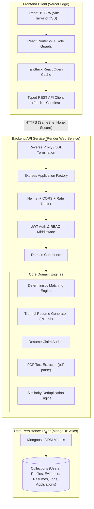
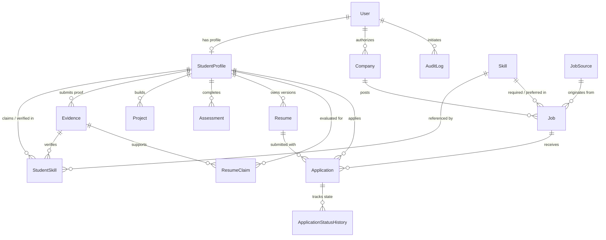
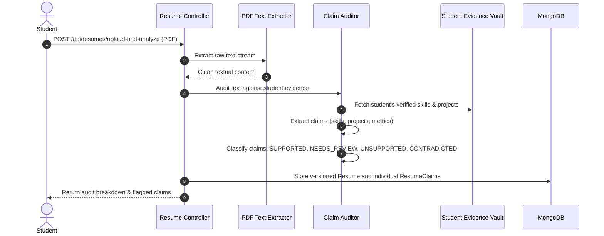

# Evidra — System Architecture & Technical Design

Evidra is an institutional placement intelligence platform designed to eliminate resume fraud, provide explainable evidence-based matching, and streamline campus recruitment pipelines.

---

## High-Level Topology



---

## Core Domain Models & Relationships



---

## Domain Engines & Subsystems

### 1. Explainable Evidence-Based Matching Engine
The matching engine evaluates candidates against job openings using **verifiable proof artifacts** rather than self-reported assertions.

#### Scoring Formula:
$$\text{Fit Score} = 100 \times \frac{\sum (w_i \times e_i)}{\sum w_i}$$

- **Required Skills Weight**: $w_i = 3$
- **Preferred Skills Weight**: $w_i = 1$
- **Evidence Verification Contribution ($e_i$)**:
  - Reviewed Coding Assessment $\ge 85\%$: $1.00$
  - Reviewed Coding Assessment $70\% - 84\%$: $0.85$
  - Reviewed Evaluated Project $\ge 80\%$: $0.90$
  - Reviewed Technical Quiz Score: ratio scaled ($0.40 - 0.85$)
  - Verified Certification: $0.75$
  - Unverified Evidence or Raw Self-Claim: **$0.00$ (Strictly excluded)**

#### Deterministic Tie-Breaking Hierarchy:
1. Eligibility Status (`MET` > `UNKNOWN` > `NOT_MET`)
2. Fit Score (Descending)
3. Verified Required Skills Count (Descending)
4. Total Verified Skills Count (Descending)
5. Academic CGPA (Descending)
6. Student Profile ID (Lexicographical ascending)

---

### 2. Evidra Resume — Truthful Resume Generator & Validator

Evidra Resume addresses the pervasive industry problem of resume embellishment and hallucination through two complementary subsystems:

```mermaid
sequenceDiagram
    autonumber
    actor Student
    participant API as Resume Controller
    participant Vault as Evidence Vault
    participant Generator as PDFKit Generator
    participant DB as MongoDB Atlas

    Note over Student,DB: 1. Truthful Generation Flow
    Student->>API: POST /api/resumes/generate (Target Job ID)
    API->>Vault: Query verified skills, projects, and assessments
    Vault-->>API: Verified records (scores, repositories, dates)
    API->>API: Draft factual bullets; link each bullet to Evidence IDs
    API->>DB: Save immutable Resume record with version N
    API-->>Student: Return resume JSON with excludedItems list

    Note over Student,DB: 2. Authenticated PDF Download
    Student->>API: GET /api/resumes/:id/pdf
    API->>API: Authorize student/officer/recruiter access
    API->>Generator: Generate 1-page ATS PDF with selectable text
    Generator-->>API: PDF Buffer
    API-->>Student: Stream application/pdf inline
```

#### Ground Rules for Truthful Generation:
- **Zero Hallucination Guarantee**: Bullets are synthesized exclusively from verified evidence and completed projects in the student's profile.
- **Evidence Traceability**: Every generated bullet retains an array of `evidenceIds` and `skillIds`.
- **Exclusion Transparency**: Unsupported skills or unverified claims are explicitly listed in `excludedItems` with user-friendly explanations.
- **Selectable-Text ATS Formatting**: Generates clean, standard typography rendered via PDFKit without rasterized text or tiny illegible fonts.

---

### 3. Uploaded Resume Claim Auditor



---

## Security Architecture & RBAC Clearance Matrix

Evidra enforces an authoritative, multi-layered Role-Based Access Control model:

| Role | Permissions & Clearances |
| :--- | :----------------------- |
| `student` | View and edit own profile; upload evidence; browse published jobs; generate truthful resumes; upload & audit resumes; submit applications; view personal match fit. |
| `placement_officer` | Full institutional oversight: review evidence; approve/reject claims; create, parse, and import jobs; run batch ranking; view student directory; view analytics & audit logs. |
| `recruiter` | Manage company profile; view assigned company jobs; view applicants for company jobs; inspect verified evidence & candidate resumes for applied candidates; advance application statuses. |
| `admin` | Full superuser access across all institutional workspaces, configuration, and audit logs. |

### Cookie & Proxy Configuration
```typescript
// Production cookie flags (server/src/config/cookie.ts)
{
  httpOnly: true,
  secure: true,       // Required for HTTPS & SameSite=None
  sameSite: 'none',   // Required for cross-site Vercel <-> Render
  maxAge: 7 * 24 * 60 * 60 * 1000,
  path: '/',
}
```
Express is explicitly configured with `app.set('trust proxy', 1)` to correctly detect TLS termination behind Render's reverse proxy load balancer.

